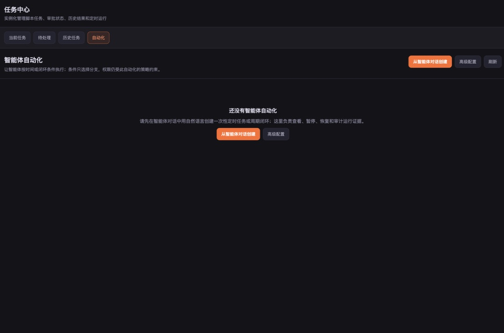
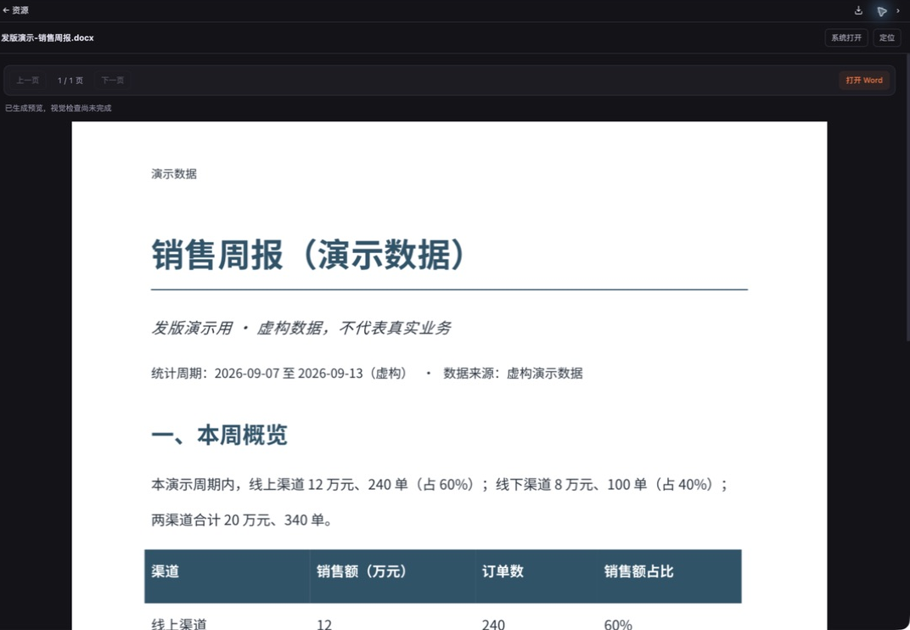
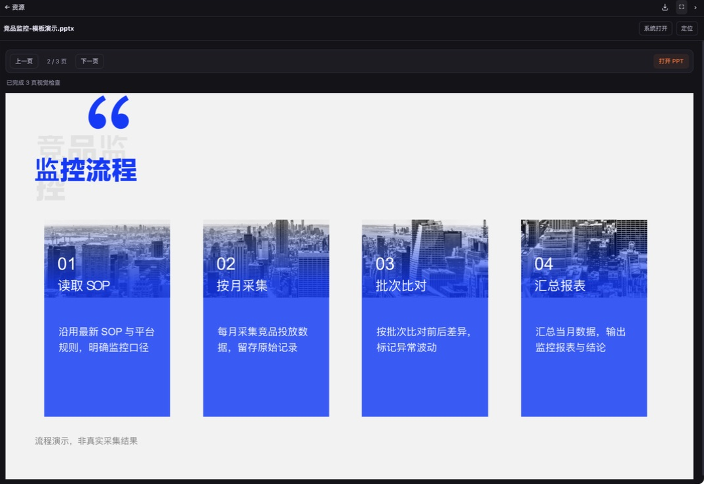
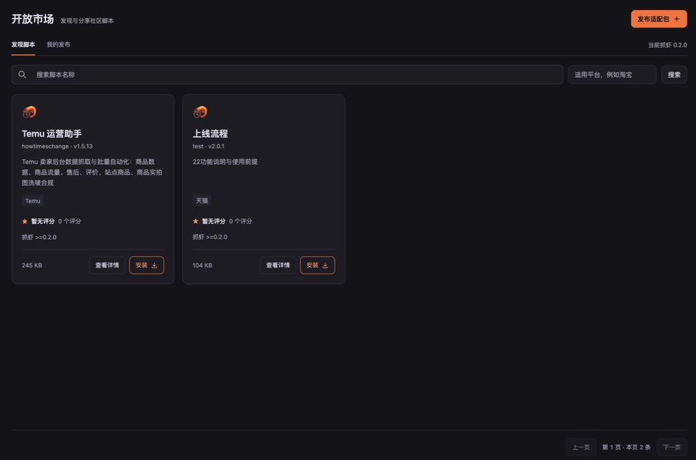
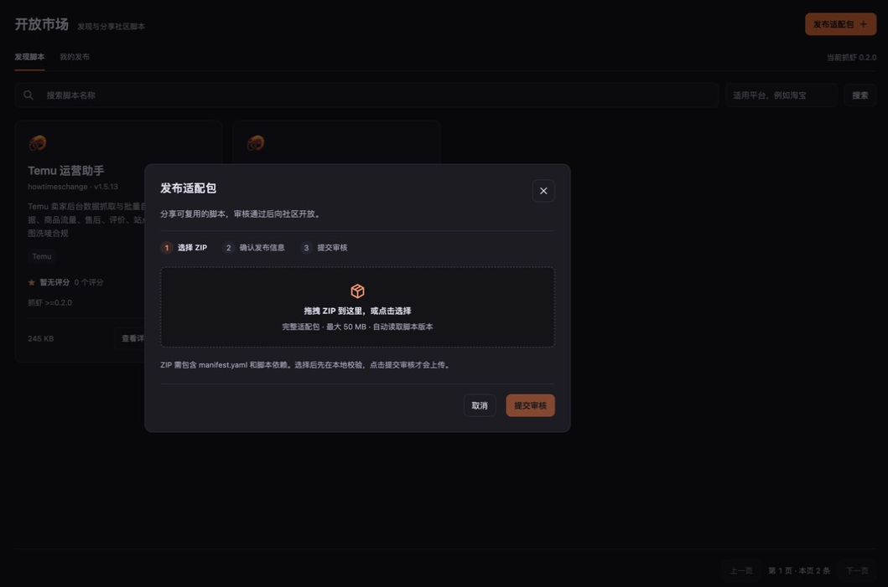
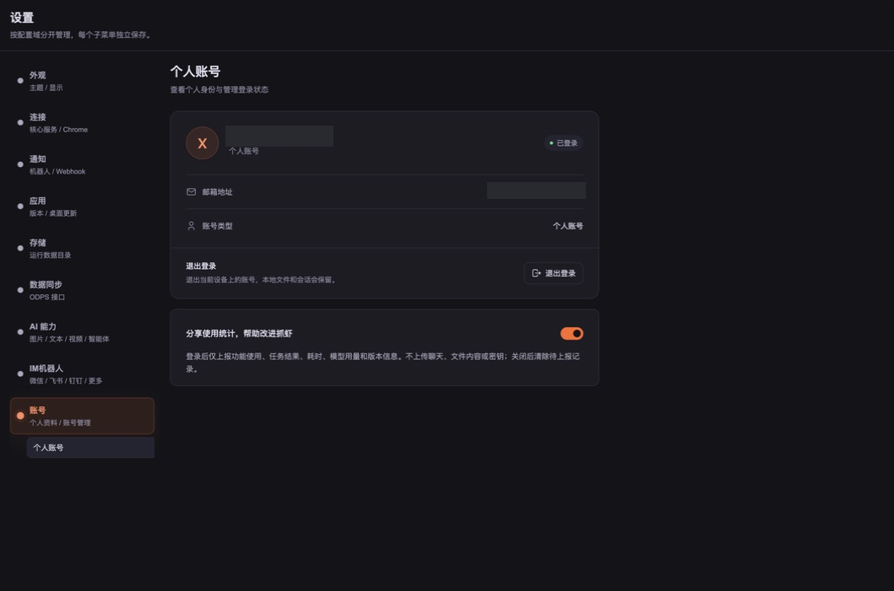
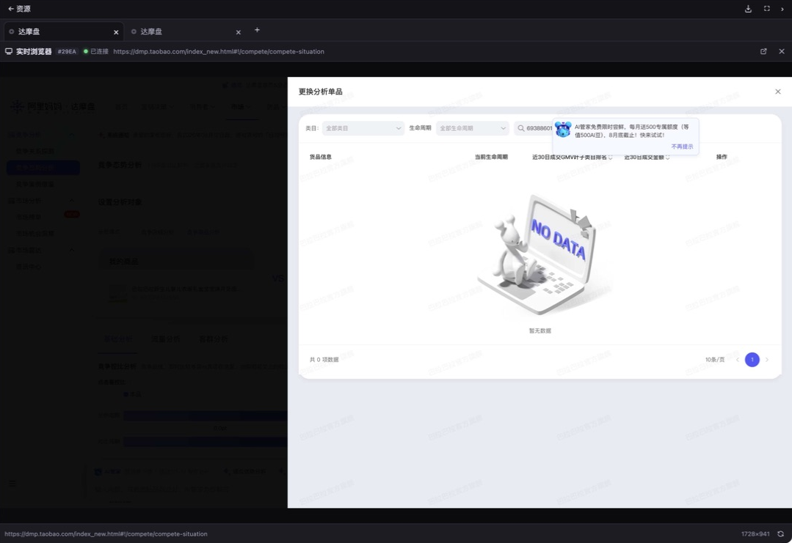

# 抓虾 Harness v0.2.0｜定时做事、交付文档、分享脚本

正式发布：2026-09-11 · 文档更新：2026-09-14

**这次更新，抓虾可以按时间执行任务，直接交付可编辑的 Word / PPT / Excel，还能通过开放市场安装和分享脚本。** 个人账号、会话资源和日志导出同步完善。
> 已安装早期 v0.2.0？本次保持版本号重新构建，请下载新版安装包覆盖安装。仅看到“0.2.0”不能判断是否包含本次更新。

## 一眼看懂本次更新

| 新功能 | 你能用它做什么 | 从哪里开始 |
|---------|---------------------|---------------|
| 自动化中心 | 定时生成日报，循环检查文件，满足条件后执行任务 | 任务中心 → 自动化；在智能体对话中创建 |
| Office 文档生成 | 一次交付可编辑 Word、PPT 和带公式的 Excel | 会话中说明目标格式并上传资料 |
| 开放市场 | 搜索、安装社区脚本，发布自己的适配包 | 开放市场 → 发现脚本 / 我的发布 |
| 个人账号 | 邮箱注册、验证码验证、登录和找回密码 | 左下角账号菜单 |
| 会话资源与日志 | 集中查看网页和产物，预览文件，导出日志 ZIP | 会话右侧资源面板 |
| 使用统计偏好 | 自主决定是否分享功能使用和任务结果统计 | 设置 → 账号 → 个人账号 |

两个重点场景：上传已有 PPT 模板，生成可编辑汇报；上传业务 SOP，智能体理解步骤后打开真实后台，按确认的参数查询和导出。下方附本次实际演示截图。

## 01 自动化中心：让任务按时继续做

在智能体对话里描述执行时间、频率、数据来源和完成条件，即可创建一次性定时任务、循环任务或条件任务。到“任务中心 → 自动化”查看状态、暂停、恢复和检查运行记录。

**可以这样试：**
> 明天上午 9 点读取工作区里的销售明细，按渠道汇总销售额，生成一份本地日报。

循环任务也可以明确停止条件，例如“每隔 30 分钟检查一次文件，资料齐全后生成汇总并停止”。电脑需要保持运行；休眠或离线后应检查任务是否错过、失败或需要复核。

图：任务中心中的自动化创建与管理入口。

## 02 Office：直接交付可以继续编辑的文件

内置 Word、PowerPoint 和 Excel 运行时，支持生成文档、填充模板、重算公式、预览和逐页检查。报告、汇报和表格可以在同一条会话里完成。
- \*\*Word：\*\*把资料整理成报告，包含结论、数据表和建议。
- \*\*PPT：\*\*先规划每页内容，再生成可编辑的演示文稿。
- \*\*Excel：\*\*汇总数据、保留公式，重算后检查结果。

演示任务：使用虚构的线上、线下销售数据，生成销售汇总表、单页周报和两页 PPT。截图中的数据均为演示数据。

图：Word 演示周报的真实客户端预览，数据均为虚构。

### 带上现有 PPT 模板，直接生成汇报内容

上传公司已有的 PPT 模板，再告诉抓虾主题和页数，智能体可以读取模板结构、复用版式并填充内容，输出可编辑 PPT。

本次演示：使用《演示文稿2.pptx》的封面、四栏内容页和结束页，生成三页《竞品投放监控方案》。保留原模板的城市背景、蓝色主题与装饰，替换标题、流程要点和占位文案，生成后逐页预览检查。
> 按这份 PPT 模板，生成三页竞品投放监控方案：封面、四项执行流程、结束页。保留模板风格，输出可编辑 PPT。

图：基于用户模板生成的封面，非真实采集结果。

图：复用模板四栏布局，填入业务流程内容。

## 03 开放市场：发现脚本，安装后直接使用

登录后在“发现脚本”按名称或平台搜索，查看作者、功能说明、使用前提、适配版本、评分和评论。安装成功后可以直接打开，也可以在“我的脚本”中找到。

安装会检查版本兼容性与包完整性；**安装不会自动执行业务任务**。

图：开放市场，搜索、查看详情与安装入口。

### 把你的脚本分享给其他人

使用绑定邮箱的账号，点击“发布适配包”，选择完整 ZIP（最大 50 MB）。客户端自动提取名称、版本、平台和说明，支持自定义图标；确认后提交审核，通过后上架。

“我的发布”支持查看审核状态、发布新版本、撤回待审提交、重新送审和下架。新版本审核期间旧版继续可用，通过后替换上架版本；修改包内容需要提高版本号。下架停止新的安装，已安装的本地副本保留。

图：完整 ZIP 在本地校验后提交审核。

## 04 个人账号：登录云端功能，本地工作照常保留

新增邮箱注册、邮件验证码、登录和找回密码。左下角账号菜单集中提供账号、设置、更新，以及核心服务和浏览器状态入口。

本地功能不要求登录。开放市场需要登录，发布脚本需绑定邮箱。退出账号不会删除本地文件和会话，账号也不会授予远程执行本机任务的权限。

### 使用统计可以自行关闭

使用统计默认开启，登录后上报功能使用、任务结果与耗时、可获取的模型用量、版本及系统信息。不采集聊天正文、文件内容、文件路径、密钥或键盘输入内容。

在“设置 → 账号 → 个人账号”关闭后，选择会在重启后保留，并清除待上报记录。

图：个人账号与使用统计开关（账号信息已遮挡）。

## 05 会话资源：文件、网页和运行证据集中查看

网页和产物统一收纳到会话资源面板，浏览器按任务需要启动。图片、Office 和 ZIP 预览更顺畅，同一 Office 文档的渲染副本合并展示，优先显示最终交付或可用预览。
- 关闭浏览器页面后，资源列表同步清理。
- 重复点击 ZIP 不再反复解压。
- 拖入文件时，拖拽提示覆盖资源区域。
- 点击“导出会话日志”，通过系统保存窗口把 ZIP 存到指定位置。

图：演示会话的产物列表与日志导出入口。

## 06 从业务 SOP 到真实网页操作

把业务操作文档交给抓虾，智能体可以理解步骤，再打开浏览器执行。不必先把每一步整理成固定脚本；页面登录态、业务参数和执行范围确认后，可按文档开展导航、筛选、查询与数据导出。

以《天猫-竞争商品ID付费投放数据监控场景SOP》为例，智能体从文档中提取：

| SOP 中的要求 | 智能体需要执行的动作 |
|----------------|------------------------------|
| DMP → 市场 → 竞争态势分析 → 竞争商品分析 | 打开真实后台，查找菜单并切换分析模式 |
| 输入本店商品 ID，竞品每次最多选 3 个 | 询问商品 ID，查询竞品并按批次处理 |
| 整月对比上一个月 | 根据指定月份设置分析与对比周期 |
| 基础分析、流量分析的表格数据 | 提取表格字段，不把图片当作数据结果 |
| 区间值取中值 | 保留原始值，按 SOP 规则整理计算值 |
| 输出月度监控报表 | 汇总商品 ID、标题及流量和投放指标，生成 Excel |

本次真实演示已完成的步骤：读取 SOP、识别业务规则、打开已登录的 DMP、进入竞争商品分析，并打开商品选择与搜索窗口。不是模拟网页或静态示意图。

商品 ID 无匹配时，页面会显示“暂无数据”；需要换成可查询的商品后继续。截图证明智能体已经操作到真实业务页面，不代表全部商品和整月数据已导出完成。
> 请按这份 SOP 打开 DMP，进入竞争商品分析。需要登录时停下让我登录，缺少商品 ID 和月份先问我，按确认的范围查询并导出 Excel。

图：智能体根据 SOP 打开真实 DMP 并执行商品查询；此处展示无匹配结果的真实状态。

每个场景使用独立会话：销售周报、PPT 模板生成、SOP 网页操作分别保留指令、产物与执行记录，便于继续任务和追溯结果。

## 模型与稳定性更新
- 默认 DeepSeek 文本模型升级至 **V4.1 Flash**，完善首次使用引导和模型选择。
- 改善 IM 附件、媒体交付和权限控制；已连接通道可继续用于下任务、查看结果和处理审批。
- 内置 DWS 钉钉 CLI、桌面操作技能及更新后的业务 CLI；macOS 增加桌面自动化权限入口。
- 修复安装包内智能体页面认证衔接，改善长输出恢复、任务取消和跨平台运行时恢复。
- 优化市场、数据、平台、提示词和任务页面的加载与异常恢复。
- 改善不同系统语言下的 Office 字体查找与预览，保留可编辑文件本身。

旧“云审批 / 任务机”和云提示词同步入口已停用；桌面与 IM 的智能体审批继续保留，本地文件和权限仍由本机管理。

## 下载与升级

**v0.2.0 已于 9 月 11 日正式发布，三个平台安装包均已提供。**

| 电脑类型 | 下载 |
|------------|------|
| Mac Apple Silicon（M 系列芯片） | [下载 macOS arm64 DMG](https://github.com/howtimeschange/crawshrimp-harness/releases/download/v0.2.0/crawshrimp-harness-v0.2.0-mac-arm64.dmg) |
| Mac Intel | [下载 macOS x64 DMG](https://github.com/howtimeschange/crawshrimp-harness/releases/download/v0.2.0/crawshrimp-harness-v0.2.0-mac-x64.dmg) |
| Windows x64 | [下载 Windows EXE](https://github.com/howtimeschange/crawshrimp-harness/releases/download/v0.2.0/crawshrimp-harness-v0.2.0-win-x64.exe) |

[查看完整发布页](https://github.com/howtimeschange/crawshrimp-harness/releases/tag/v0.2.0)

已有用户：先退出抓虾，再安装新包；Mac 将应用拖入“应用程序”替换，Windows 按安装向导完成。已安装较早的 v0.2.0 也需要手动覆盖安装，以获得本次新增功能。

新用户：安装后配置可用模型，新建会话即可开始。需要市场功能时再登录账号，需要 IM 时进入“设置 → IM机器人 → 机器人接入”。

文档截图来自实际客户端，已裁去无关会话并遮挡账号信息。Office 示例使用虚构数据。源码中后续的账号菜单不透明背景修复仍在构建中，未作为当前安装包已交付功能列入。

## 反馈问题

请提供系统版本、安装包名称、任务指令和异常截图。Office 问题注明页码或工作表；市场问题注明脚本名称、版本和状态；自动化问题注明预期执行时间与运行记录。需要时附上会话日志 ZIP，分享前检查其中的业务信息。
