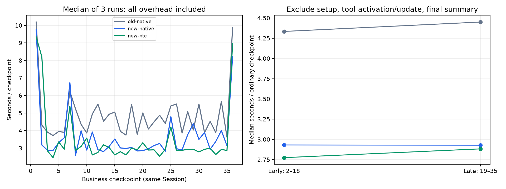

# 36 步商品审核：三配置长任务对比（2026-10-22）

共 3 配置 × 3 次 = 9 次完整任务，324 个业务批次、7,776 行商品决策逐项核对全部通过。第7步加载 delegation 并使用 todo_write、后续进度更新和最终汇总也通过。每组是36个**外部逐批推进的连续业务回合**，同一会话不重启；不是单一 prompt 完全自主执行，也不是限定36次模型请求。

## 方法

- 官方 DeepSeek Flash，reasoning=off，同一授权 key；旧版0.1.2-rc.1原生工具，新版0.2.1-rc.2原生工具，新版持久PTC。
- 相同864条合成商品资料，每批24条，共36批。检查条码、产地、价格下限、缺货数量，写出逐行审核结果与总汇总。所有输入SHA256一致；允许各组复用脚本/函数。
- 独立数据和工作区，串行运行；三轮顺序为旧→新→PTC、新→PTC→旧、PTC→旧→新。保留全部结果，不挑最快样本。
- 总耗时包含连续36回合及校验/订阅开销，不含服务启动。token按所有已返回的逐请求usage累加，含模型自我纠错；没有额外人工重试。未强制压缩，最大单次输入上下文见下表。
- 工具调用次数仅为外层工具，PTC一次run_code可含多项工具或文件操作，不等同底层操作数量。

## 完整任务结果

| 配置 | 完成 | 三次耗时（秒） | 中位数 | 实际模型请求次数 |
|---|---|---|---:|---|
| 旧版原生 | 3/3 | 125.171 / 174.08 / 223.512 | 174.080 秒 | 80 / 128 / 148 |
| 新版原生 | 3/3 | 128.147 / 125.245 / 176.765 | 128.147 秒 | 80 / 81 / 118 |
| 新版PTC | 3/3 | 116.87 / 164.146 / 115.323 | 116.870 秒 | 80 / 88 / 80 |

本轮中位数：新版原生比旧版快 26.4%；PTC比旧版快 32.9%，比新版原生快 8.8%。**这包括模型执行策略变化，不是纯内核算力提升。** 三次样本的时延范围明显重叠，不能声称固定提速比例或统计显著。

## 累计 token（每配置三次任务合计）

| 配置 | 非缓存输入 | 缓存读取 | 输出 | 最大单次输入上下文 |
|---|---:|---:|---:|---:|
| 旧版原生 | 165,209 | 12,203,008 | 76,397 | 79,324 |
| 新版原生 | 70,496 | 6,544,128 | 60,819 | 39,603 |
| 新版PTC | 52,539 | 6,082,176 | 63,713 | 51,560 |

旧版适配器明确省略值为0的cache字段，按其契约还原0；新版使用实际返回值。上表不等于唯一上下文大小：多轮缓存读取累加会重复计算历史。缓存无法人为清空，不能把非缓存降幅直接等同账单降幅。没有缺失usage的失败模型请求；工具错误对应的模型输出已计入。

## 后半程是否越来越慢

逐次比较普通批次：前半程2–18（除7）、后半程19–35（除25），每半16批。第1步建环境、第7步动态加载、第25步更新任务、第36步汇总只从这一诊断中排除，仍完整计入总耗时。

| 配置 | 第一轮后半变化 | 第二轮后半变化 | 第三轮后半变化 | 三次变化中位数 |
|---|---:|---:|---:|---:|
| 旧版原生 | +6.2% | +2.7% | -1.9% | +2.7% |
| 新版原生 | +1.6% | -0.1% | +14.7% | +1.6% |
| 新版PTC | +9.9% | -8.5% | -11.2% | -8.5% |

正数表示后半程较慢，负数表示较快。未发现三组均随历史增长而持续恶化的模式；网络波动、输出长度和执行策略同时影响结果，不能把这些变化单独归因于内核历史处理复杂度。

## 正确性与错误恢复

- 旧版原生：工具错误 0 次；最终成功 3/3。
- 新版原生：工具错误 0 次；最终成功 3/3。
- 新版PTC：工具错误 11 次；最终成功 3/3。

PTC出现过静态import、重复声明等代码执行错误，均由模型在同一任务内自我修正，费用/耗时均保留。第二轮PTC每批重新生成较长代码，耗时164秒；第三轮更充分复用函数，耗时115秒。旧版也从首轮单次bash发展为后续多次计算/校验调用，造成80→128→148次模型请求。不能把这些策略差异隐去后只宣传“内核提速”。

外部oracle要求最终：36批、864行，ready332 / hold297 / review235，缺货3905，订单金额18050788分。每个SKU决策和缺货值、每批统计与总统计均检查。

## 结论与范围

这类连续、可复用计算的商品审核任务里，**新版整套配置表现更好，PTC中位数更快，但也引入更多可恢复的代码错误**。尚不能据此默认开启PTC：本基准没有真实抓虾MCP生态工具、生图/视频、实际网站脚本，也没有跨压缩的持久状态验证。用户已将下一阶段重点指定为生态工具效率与兼容性；是否默认开启，以该阶段实际结果为准。

3次/组不是生产成功率估计，不能从3/3推断“100%可靠”；本测试为合成数据、关闭思考、单机，不代表数小时自主任务或百万token上下文。

证据：[逐步结果及usage](qa-2026-10-22-longtask/results.json)、[汇总](qa-2026-10-22-longtask/summary.json)、[测试计划](qa-2026-10-22-longtask/study-plan.json)、[执行脚本](qa-2026-10-22-longtask/run.mjs)、[分析脚本](qa-2026-10-22-longtask/analyze.py)。脚本依赖本机运行时路径，复跑必须改输出目录，密钥仅由stdin注入。没有提交或发布。
